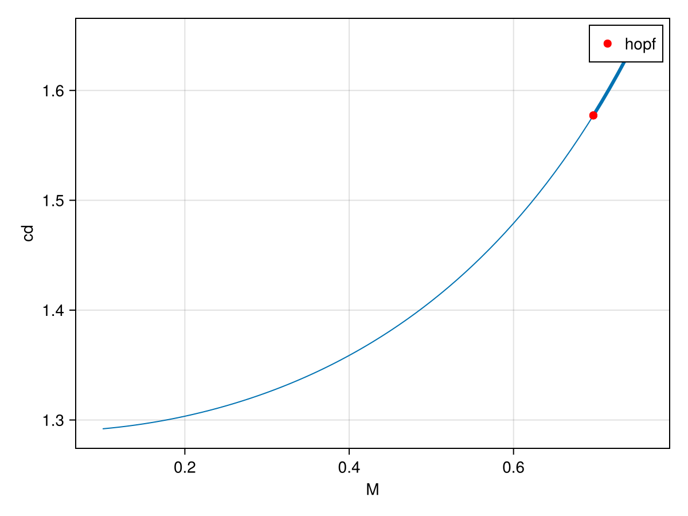
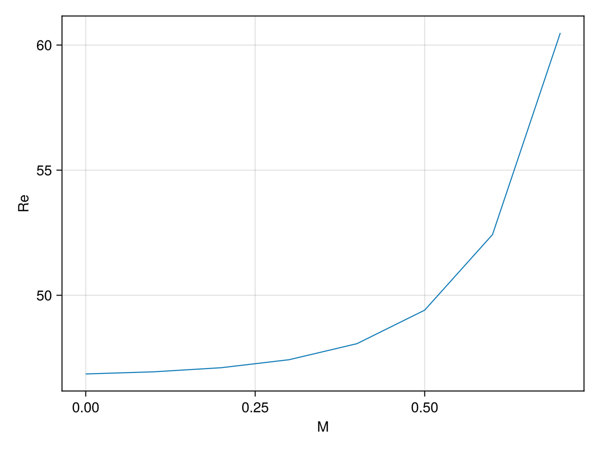
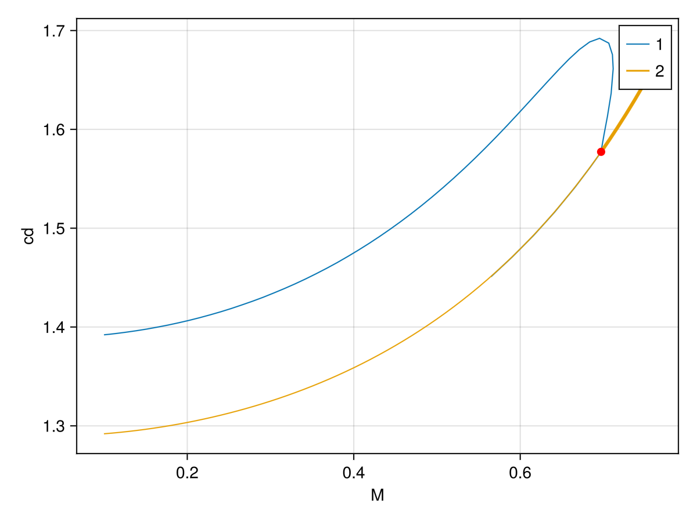

# [🟤 Compressible flow past a cylinder: state-dependent mass, Hopf bifurcation and periodic orbits](@id cylinder)

```@contents
Pages = ["cylinder.md"]
Depth = 3
```

This tutorial is about the 2-D compressible flow past a cylinder. It is a translation to Gridap of the example from the
[ff-bifbox](https://github.com/cmdoug/ff-bifbox) paper [^DouglasJolivet]. The equations are the following:

$$\begin{align}
    \left(\gamma{}M^2p+1\right)\left(\frac{\partial\boldsymbol{u}}{\partial t}+\boldsymbol{u}\boldsymbol{\cdot}\boldsymbol{\nabla}\boldsymbol{u}
    \right)+T\left(\boldsymbol{\nabla}{}p-\boldsymbol{\nabla}\boldsymbol{\cdot}\boldsymbol{\tau}\right)&=0,\\
    \hspace{-1mm}\left(\gamma{}M^2p+1\right)\left(\frac{\partial{}T}{\partial t}+\boldsymbol{u}\boldsymbol{\cdot}\boldsymbol{\nabla}{}T+\left(\gamma-1\right)T\left(\boldsymbol{\nabla}\boldsymbol{\cdot}\boldsymbol{u}\right)\right)-\left(\gamma-1\right)\gamma{}M^2T\left(\boldsymbol{\nabla}\boldsymbol{u}\boldsymbol{:}\boldsymbol{\tau}\right)-\frac{\gamma{}T}{RePr}\nabla^2T&=0,\\
    \gamma{}M^2T\left(\frac{\partial{}p}{\partial t}+\boldsymbol{u}\boldsymbol{\cdot}\boldsymbol{\nabla}{}p\right)-\left(\gamma{}M^2p+1\right)\left(\frac{\partial{}T}{\partial t}+\boldsymbol{u}\boldsymbol{\cdot}\boldsymbol{\nabla}{}T-T\left(\boldsymbol{\nabla}\boldsymbol{\cdot}\boldsymbol{u}\right)\right)&=0,
\end{align}$$

where $\tau_{ij}=\frac{\partial u_i}{\partial x_j}+\frac{\partial u_j}{\partial x_i}-\frac{2}{3}\delta_{ij}\frac{\partial u_k}{\partial x_k}$.
We refer to the paper[^DouglasJolivet] for the boundary conditions.
The unknowns are $q=(u,T,p)$: the velocity $u$, the temperature $T$ and the
pressure $p$. The parameters are

```math
p = (Re, Pr, M, \gamma),
```

where $Re$ is the Reynolds number, $Pr$ the Prandtl number, $M$ the Mach number and
$\gamma$ the ratio of specific heats. The semi-discretized problem is a
differential-algebraic equation with a **state-dependent mass matrix**:

```math
M(q)\,\partial_t q = F(q;p).
```

The pressure does not carry a time derivative, so $M(q)$ is singular. This is essential
for the stability analysis: the relevant spectrum is the generalized eigenvalue problem
$J\phi=\lambda M\phi$, not the spectrum of $J$ alone.

!!! info "Problem size"
    This is a massive problem to be run on github CI or even on your laptop. Apart from the size, it is not very difficult. We try our best to generate the plot online but this cannot be done for everything...

## Mesh and finite element spaces

The geometry is the rectangle $[-100,150]\times[-100,100]$ minus the unit-diameter disk at
the origin.
The mesh generator and the weak forms are in the helper files distributed with the
example.

```@example CYLINDER
cd(@__DIR__)
using CairoMakie
CairoMakie.activate!()
using GridapMakie
using Gridap.Geometry
using GridapGmsh
using LinearAlgebra
using BifurcationKit, GridapBifurcationKit
const BK = BifurcationKit
path = "../../../example/"
include(path * "mesh_cylinder.jl")
include(path * "cylinder_defs_kernel.jl")

full = true
meshfile = joinpath(path, "meshes", full ? "cylinder_full.msh" : "cylinder.msh")
isfile(meshfile) || generate_cylinder_meshes(; n0 = 25)
model = GmshDiscreteModel(meshfile; has_affine_map = true, renumber = false)
X, Y = cylinder_spaces(model; full)
order = 4
Ω, dΩ, bsds = cylinder_measures(model, order)
forms = cylinder_forms(bsds, dΩ)
(; res, jac, mass, dM, apply_mass) = forms
cylinder_drag = prep_cylinder_drag(model, order)
```

The spaces are Taylor–Hood elements: velocity and temperature of degree 2, pressure of
degree 1. The velocity satisfies the no-slip condition on the cylinder and the inlet
condition upstream; the temperature is fixed at the inlet.

## Weak forms and the state-dependent mass

The residual `res` and its jacobian `jac` are written close to the variational
formulation; their full expressions are in `cylinder_defs_kernel.jl`. The next functions are a specific norm, a record/plot function for continuation.

```@example CYLINDER
function Norm(x)
    qtemp = FEFunction(X, x, Gridap.FESpaces.zero_dirichlet_values(X))
    n = sum(∫(qtemp⋅qtemp)dΩ)
    s = sum(∫(1)dΩ)
    sqrt(n/s)
end

function record(x, p; iter = nothing, state = nothing, k...)
    qrec.free_values .= x # qrec is a cont defined below
    u, = qrec
    Re = isnothing(iter) ? 80.0 : BK.getparams(iter, state).Re
    return (;cylinder_drag(qrec, Re)..., 
            uxmin = minimum(get_free_dof_values(u)),
            uxmax = maximum(get_free_dof_values(u)),
                 )
end

function plot_solution(ls, x, p; id_var = 1, ax1, iter, state, k...)
    # qrec is a cont defined below
    if length(x) == length(qrec.free_values)
        qrec.free_values .= x
    else
        qrec.free_values .= x[1:end-2] # for hopf
    end
    var_to_plot = qrec[id_var]
    hm = plot!(ls, Ω, var_to_plot, colormap=:bwr)
    xlims!(ls, -5, 30); ylims!(ls, -7, 7) 
    gc = ls.layoutobservables.gridcontent[]
    gp = gc === nothing ? ls.figure[1, 2] :
         gc.parent[gc.span.rows, maximum(gc.span.cols) + 1]
    Colorbar(gp, hm)
end
```

We pass these forms to the bifurcation problem:

```@example CYLINDER
par0 = cyl_par(M = 0.1, Re = 70.0)
const qrec = zero(X) # place holder used for plotting
q0 = interpolate_everywhere([VectorValue(1.0, 0.0), 1.0, 0.0], X) # basic guess for newton

prob = GridapBifProblem(res, q0, par0, Y, X, dΩ, (@optic _.M);
    jac,
    mass,
    ∇xM = dM,
    applyM = apply_mass,
    d2res = BK.FiniteDifferences(),
    record_from_solution = record,
    plot_solution = plot_solution
    )
```

The `∇xM` and `applyM` keywords are optional but useful: they tell `BifurcationKit.jl` how to
differentiate and apply the mass operator without assembling it repeatedly. The default
parameter derivatives are computed by finite differences.

## Base flow and continuation in the Mach number

We compute the base state with a Newton solver:

```@example CYLINDER
# shift invert eigensolver
eig = BK.EigArnoldiMethod(sigma = 0.1 + 0.7im, which = BK.LM(), tol = 1e-7)
optn = BK.NewtonPar(tol = 1e-8, max_iterations = 15, verbose = true,
    eigsolver = eig,)
sol = BK.solve(prob, BK.Newton(), optn; normN = Norm)
```

```@example CYLINDER
fig = Figure(size = (1000, 500))
ls1 = Axis(fig[1, 1],  title = "$(sol.prob.params)")
plot_solution(ls1, sol.u, nothing; id_var = 1, ax1 = 1, iter = 1, state = 1)
fig
```

The base state is then continued in the Reynolds number fixed.

```julia
opts = BK.ContinuationPar(p_max = 0.75,
    ds = 1e-2, dsmax = 1e-2,
    detect_bifurcation = 3, newton_options = optn,
    nev = 30, tol_stability = 1e-6, 
    save_eigenvectors = false,)

prob.u0 .= sol.u
br = BK.continuation(prob, BK.Natural(), opts;
    callback_newton = BK.cbMaxNorm(1),
    normC = Norm
    )
BK.plot(br)[1]
```



## Hopf bifurcation curve

We can continue the previously found Hopf bifurcation point:

```julia
opts_hopf = ContinuationPar(p_max = 0.7, p_min = 0.0, ds = 1e-1, dsmax = 1e-1 detect_bifurcation = 0, newton_options = optn, tol_stability = 1e-6, detect_event = 0)

br_h = BK.continuation(br, 1, (@optic _.M), opts_hopf;
    alg = Natural(), 
    update_minaug_every_step = 1,
    normC = norminf,

    bdlinsolver = BorderingBLS(DefaultLS()),
    jacobian_ma = BK.MinAugMatrixBased(),
    callback_newton = callback_hopf,
    usehessian = true,

    detect_codim2_bifurcation = 0,
)

BK.plot(br_h)[1]
```




## Periodic orbits

The branch of periodic orbits is computed with the trapeze (Crank–Nicolson) method. Since
the underlying problem carries a mass matrix, `Trapeze` automatically solves the
mass-weighted time steps.

A first guess is obtained from the Hopf eigenvector:

```julia
M = 20
pred = BK.predictor(hp, 0.3; ampfactor = 0.18)
list_of_time_steps = [pred.orbit(t) for t in range(0, 2pi; length = M + 1)[1:M]]
orbitguess_f = vcat(reduce(vcat, list_of_time_steps), pred.period)

ϕ = normalize(rand(length(prob.u0)))
poTrap = BK.Trapeze(BK.re_make(prob, params = par_po),
    ϕ,
    zero(prob.u0),
    M,
    length(prob.u0);
    jacobian = BK.FullLU())
BK.updatesection!(poTrap, orbitguess_f, par_po)

function plot_po(ax, x, p; ax1, iter, state, k...)
    wrap = BK.getprob(iter)
    trap = BK.get_discretization(wrap)
    sol_t = BK.get_periodic_orbit(poTrap, x, nothing)
    lines!(ax, sol_t.t, sol_t.u[end,:])
end
```

We find the orbit with a preconditioned Newton–Krylov solver. The circulant
preconditioner is built from the orbit averaged jacobian:

```julia
using FFTW
FFTW.set_num_threads(6)
P = BK.POTrapCirculantPrec(poTrap, orbitguess_f, par_po, ref = :average)
ls_po = BK.GMRESIterativeSolvers(verbose = true, reltol = 1e-6, abstol = 1e-8,
    N = length(poTrap), restart = 50, maxiter = 60,
    Pl = P, log = true)
eig_po = BK.EigArnoldiMethod(x₀ = rand(length(prob.u0)))
optn_po = BK.NewtonPar(linsolver = ls_po, eigsolver = eig_po,
    verbose = true, tol = 1e-6, max_iterations = 15)

outpo = BK.newton(poTrap, orbitguess_f, optn_po;
    normN = NormL2T, callback = BK.cbMaxNorm(1))
```


Finally, we continue the periodic orbit in the Mach number. The finalise callback refreshes the circulant preconditioner after each successful
continuation step. The `record_po` callback stores the extrema of the drag coefficient along the orbit, so
the bifurcation diagram is directly the amplitude of the drag oscillation:

```@example CYLINDER
function update_preconditioner(z, tau, step, contResult; state, iter)
    success = BK.converged(state)
    bisection = BK.in_bisection(state)
    if success && !bisection
        par = BK.getparams(iter, state)
        contparams = iter.contparams
        @reset par.M = par.M + contparams.ds
        Prec = contparams.newton_options.linsolver.Pl
        trap = BK.get_discretization(BK.getprob(iter))
        BK.update_preconditioner!(Prec, trap, z.u, par; ref = :average)
    end
    return true
end

function record_po(x, p; iter, state, k...)
    par = BK.getparams(iter, state)
    sol_t = BK.get_periodic_orbit(poTrap, x, par)
    cds = [_cd(sol_t.u[:, j], par) for j in axes(sol_t.u, 2)]
    cdm, cdx = extrema(cds)
    return (; cdx, cdm, amp = cdx - cdm, period = x[end])
end
```

```julia
opts_cont_po = BK.ContinuationPar(p_max = 0.75, p_min = 0.0,
    ds = 9e-3, dsmax = 9e-3, max_steps = 50,
    detect_bifurcation = 0,
    newton_options = BK.NewtonPar(optn_po; max_iterations = 5),
    )

br_po = BK.continuation(poTrap, outpo.u, BK.PALC(tangent = BK.Secant()), opts_cont_po;
    linear_algo = BK.MatrixFreeBLS(ls_po, false),
    verbosity = 2,
    normC = NormL2T,
    plot = true,
    finalise_solution = update_preconditioner,
    record_from_solution = record_po,
    plot_solution = plot_po)
```


```julia
f, ax = BK.plot(br, br_po)
f
```




## References

[^DouglasJolivet]:> Douglas, Christopher M., and Pierre Jolivet. **ff-bifbox: A scalable, open-source toolbox for bifurcation analysis of nonlinear PDEs.** *Computer Physics Communications* 326 (2026): 110221. DOI: [10.1016/j.cpc.2026.110221](https://doi.org/10.1016/j.cpc.2026.110221).
